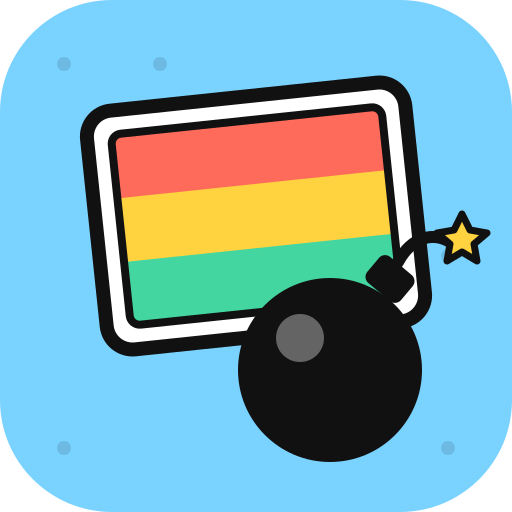
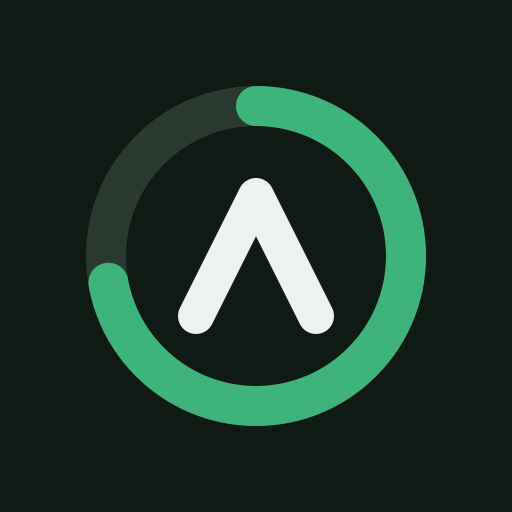

# Hej! 👋

Här är mina projekt. De flesta är små webbappar utan byggsteg och utan beroenden, och många är byggda tillsammans med AI-agenter.

**Status:** 🟢 aktivt, uppdateras nu · 🟡 under utveckling · 🧪 labb eller prototyp · 📐 designfas · ✅ fungerar, vilar just nu

## Spel

| | Projekt | Beskrivning | Status |
|:-:|---|---|---|
|  | **[Fel nummer](https://github.com/paokarlsson/fel-nummer)** [Spela](https://paokarlsson.github.io/fel-nummer/) | Deckaräventyr i sms. Ditt nya kontantkort har tillhört någon annan, och personerna som skriver är självstyrande AI-agenter. | 🟢 Aktivt |
|  | **[Passa flaggan](https://github.com/paokarlsson/passa-flaggan)** [Spela](https://paokarlsson.github.io/passa-flaggan/) | Partyspel om flaggor och länder för en mobil och ett helt sällskap. Fungerar offline. | 🟢 Spelbart |
|  | **[Ergcopter](https://github.com/paokarlsson/ergcopter)** [Spela](https://paokarlsson.github.io/ergcopter/) | Effekten från en Concept2 SkiErg lyfter en räddningshelikopter. Så högt som möjligt, och Fjällräddaren med lektioner och uppdrag. | 🟡 Under utveckling |
|  | **[vamp](https://github.com/paokarlsson/vamp)** [Spela](https://paokarlsson.github.io/vamp/) | Adaptiv loopmotor för piano med MIDI. Spelet håller dig precis på gränsen av vad du klarar. | 🧪 Prototyp |
|  | **[Wheelie Life](https://github.com/paokarlsson/wheelie-life)** [Spela](https://paokarlsson.github.io/wheelie-life/) | Bygg din elkick i butiken och kör på bakhjulet så långt du kan medan kvällen blir natt. | ✅ Spelbart |

## Lära och öva

| | Projekt | Beskrivning | Status |
|:-:|---|---|---|
|  | **[Ganger](https://github.com/paokarlsson/ganger)** [Öppna](https://paokarlsson.github.io/ganger/) | Öva multiplikationstabellen med tre spel och se hur många av tabellens 55 fakta som sitter. | ✅ Fungerar |
|  | **[Svengelska](https://github.com/paokarlsson/svengelska)** [Öppna](https://paokarlsson.github.io/svengelska/) | Glosträning där veckans glosor svepas rätt eller fel, åt båda hållen och mot ett tempo. | 🧪 Nerskalat test |
|  | **[Italiano](https://github.com/paokarlsson/italiano)** [Öppna](https://paokarlsson.github.io/italiano/) | Öva italienska: fyra pelare, 66 kortlekar och drygt tusen frågor med automatisk repetition. | ✅ Fungerar |
|  | **[Sjunga](https://github.com/paokarlsson/sing)** [Öppna](https://paokarlsson.github.io/sing/) | Psalmspelaren med fria melodier ur psalmboken, och Mic → MIDI som gör om sång till noter. | ✅ Fungerar |
|  | **[Stakometer](https://github.com/paokarlsson/stakometer)** [Öppna](https://paokarlsson.github.io/stakometer/) | Träningsapp för SkiErg: läser PM5 i realtid och visar målzon, kapacitet och ett W′-batteri live. | 🟡 Under utveckling |

## Vardag och hjälpmedel

| | Projekt | Beskrivning | Status |
|:-:|---|---|---|
|  | **[Bromsfri körning](https://github.com/paokarlsson/ecodriving)** [Öppna](https://paokarlsson.github.io/ecodriving/) | Säger till när du ska släppa gasen så att bilen rullar ner till rätt fart före ljus, kurvor och rondeller. | 🟢 Aktivt |
|  | **[Talmoln](https://github.com/paokarlsson/listen-support)** [Öppna](https://paokarlsson.github.io/listen-support/) | Stöd för att hänga med i ett samtal: visar med lättläst svenska vad samtalet handlar om just nu. | 🟢 Aktivt |
|  | **[Psykologen](https://github.com/paokarlsson/psykologen)** | Lärprojekt i fullstack med Angular, Java och ett AI-API. Ingen riktig psykolog. | 🧪 Labb |
|  | **[Kardborre](https://github.com/paokarlsson/kardborre)** [Öppna](https://paokarlsson.github.io/kardborre/) | En hyllning till växten som uppfann kardborrebandet: botanik, folktro, frön och odling. | ✅ Klar |
|  | **[tech-blogg](https://github.com/paokarlsson/tech-blogg)** [Läs](https://paokarlsson.github.io/tech-blogg/) | Min blogg på svenska och engelska, byggd med Eleventy. | 🟢 Publicerad |

## Ramverk

| | Projekt | Beskrivning | Status |
|:-:|---|---|---|
|  | **[Spola](https://github.com/paokarlsson/spola)** | Java 25-ramverk som gör det ett webb-API behöver från Spring Boot och Lombok, utan ett enda beroende utanför JDK:n. Byggs av AI-agenter efter behov. | 🟡 0.x, labb |
|  | **[Sola](https://github.com/paokarlsson/Sola)** | Frontendramverk utan beroenden och utan byggsteg. Syskon till Spola, och tillsammans ska de bli en fullstack helt utan beroenden. | 📐 Designfas |
